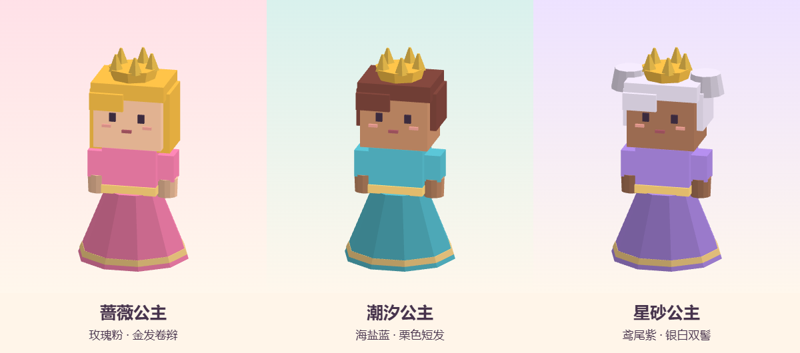

# 皇冠积木城｜公主换装游戏策划案 v1.1 · 工坊版

[打开可玩 HTML 原型](index.html)　·　[查看三位公主角色原画](公主角色设定.png)

## 一张属于玩家的城堡明信片

面向喜欢公主装扮、轻量街机和拍照收藏的玩家。首次体验的目标是「替公主赚到一件新配饰，在最配它的地方拍一张照片」。开场即拥有完整造型，可以先试拍，再决定为哪件衣服攒钱。三位公主共享钱包、衣物和相册，换角色不会损失搭配投入。

**首局示例**　选择星砂公主 → 看中 16 币的薄荷蝴蝶结 → 进入王国问答，答对三题得 18 币 → 兑换后余额为 2 币 → 去星灯露台，转动展台，让头饰避开后方灯柱 → 拍照，点相册中的明信片下载。

## 角色与场景美术

|角色|远看轮廓|搭配方向|
|---|---|---|
|蔷薇公主|金色长发从王冠两侧垂下，粉色宽裙摆|花瓣礼裙呼应城墙，薄荷头饰与粉墙形成色差|
|潮汐公主|齐颊栗色短发，海盐蓝裙身露出肩线|珊瑚花冠与花园暖色花簇呼应|
|星砂公主|银白双髻外扩，淡紫裙身|午夜星裙压低衣身明度，让金星魔杖在夜景中突出|

参考图 1 的粉墙、蓝尖顶、金冠饰和灰蓝基座，用原创几何形体重绘。人物共享积木躯干、短臂和分段裙摆，靠发型、肤色和服饰辨识。展台以略俯视的正交镜头起步，背景留出天空，人物站在建筑前排。金色只用于冠饰、塔尖、裙边和金币反馈。

|场景／打卡点|构图和操作意图|元梦地图布置建议|
|---|---|---|
|皇冠城门／迎宾台|高低塔形成天际线，转过小角度可让人物与门框错开|出生朝向城门，衣橱交互放在玩家与城门之间|
|蔷薇花园／花径喷泉|粉花、绿树围合蓝色喷泉，适合拍清浅色裙子|从城门侧翼进入，花丛后退，留出完整裙摆空间|
|星灯露台／金灯栏杆|低栏杆和金灯排成横线，双髻与王冠露在天空中|与花园设置双向入口，灯柱避开默认拍照视线|

## 两种视角，一套操作逻辑

|界面|玩家看到什么|输入与结果|
|---|---|---|
|选角|城堡全景、三张同尺度角色卡|点角色卡进入展台；在展台可重新选择|
|3D 展台|公主、当前地点、钱包和场景按钮|横拖旋转或点转动按钮；切地点时保留全套搭配|
|衣橱|礼裙、头饰、手持三行，各有初始选项|按钮明示价格，点击兑换并穿戴；已拥有可免费切换，余额不足显示差额|
|2D 游乐厅|三项入口，各有规则页|开始后进入独立挑战，结算页可再玩、换项目或直接回衣橱|
|拍照与相册|当前角度、装扮及地点署名|点击拍照生成干净画面；最近六张本地保存，可下载 PNG|

## 三个小游戏

|玩法|规则、反馈、结束条件|收益|
|---|---|---|
|王国问答|从六道颜色、构图和积木常识题中抽五题，每题二选一。答后显示对错，答错显示正确答案，由玩家推进下一题|每题 6 币，单局 0–30 币|
|企鹅冰原冒险|以经典红白机企鹅向地平线滑行为参考。冰道从地平线向两侧展开，左右键逐道切换，空格跳裂缝；海豹必须换道避开。三颗心耗尽结束，滑行 600 米通过旗门|每条鱼 3 币，通关再加 12 币；失败保留已得鱼奖励|
|金币雨|篮筐在底部水平移动，按住方向键或屏幕左右键持续移动。落币进入篮口范围时计分，漏接继续，20 秒结算|每枚 2 币，可反复挑战|

街机可主动暂停、提前结算，窗口失焦自动暂停。重开会清空上局挑战状态。企鹅关按约 25 秒、三冰道重构，采用原创像素企鹅和浏览器绘制的冰原，未采样原作 ROM、关卡数据、音轨或逐帧手感。原型以浏览器时间驱动，限速更新，真机帧率和触控手感待调校。

## 衣橱经济

|部位|免费起点|解锁款式|
|---|---|---|
|礼裙|公主初始色|花瓣礼裙 24 币、午夜星裙 42 币|
|头饰|金冠|薄荷蝴蝶结 16 币、珊瑚花冠 28 币|
|手持|空手|金星魔杖 32 币|

三个部位独立穿戴，解锁五件后共有 18 种部位组合，每种均可跨角色跨场景拍摄。首饰价格允许玩家答对三题就获得第一次可见变化。全衣橱共需 142 币，相当于五局满分问答。首轮试玩重点观察首次购买前离开比例、哪种小游戏最常重玩，以及买完第一件后是否能自行找到拍照入口。

## 元梦实现与验收

网页是单人离线可操作样机，三维展台由几何面实时投影并支持转动。工坊首页「积木地图工坊」可进入本作。页面引用仓库内置 three.js；展台、角色和照片使用同一份几何数据，浏览器不支持 WebGL 时使用 Canvas 绘制。角色设定图由同一模型输出。参考图仅用于确定视觉方向。小游戏个别图标由系统表情字体显示，外观随平台变化。

元梦版建议将衣橱、小游戏入口和三个拍摄站分设为可交互点。玩家靠近时出现操作提示，进入 2D 挑战时记录返回位置；结算后回到原点并恢复角色输入。拍摄站固定初始朝向，开放转镜，快门时隐藏操作栏。每名玩家独立保存角色、金币、已购集合、三个穿戴槽与相册索引。联机版以单局编号结算一次，购买时一起提交扣款与解锁，避免重连重复到账。

浏览器验证覆盖三张选角卡、五题结算、扣币穿戴、切场景转镜、拍照入册和两款街机的计时结算。未写入元梦编辑器。地图尺寸、资源编号与碰撞净空需在目标地图中测量；手机多点触控、多人同场穿戴同步、实机拍照权限和断线恢复列入下一阶段验收。
